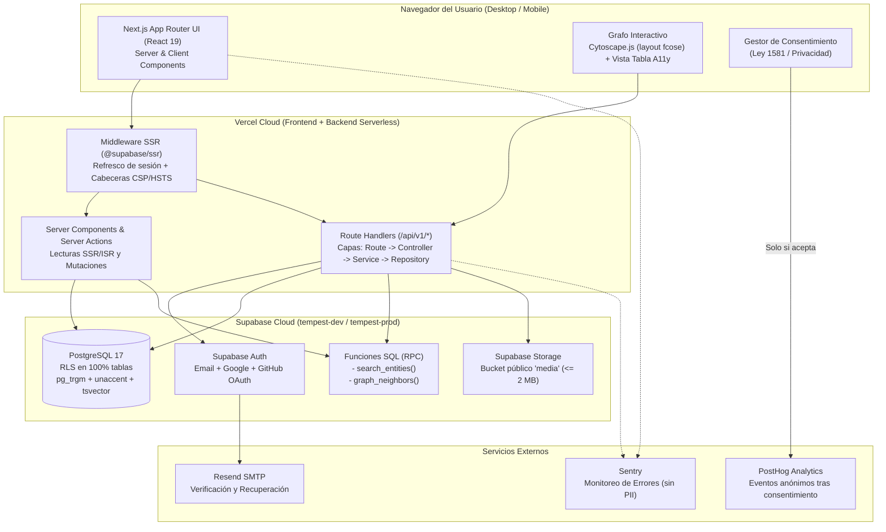
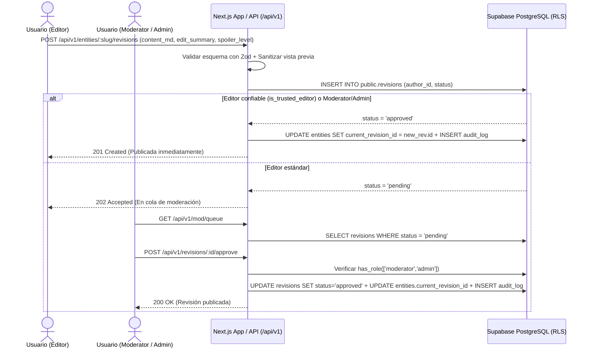
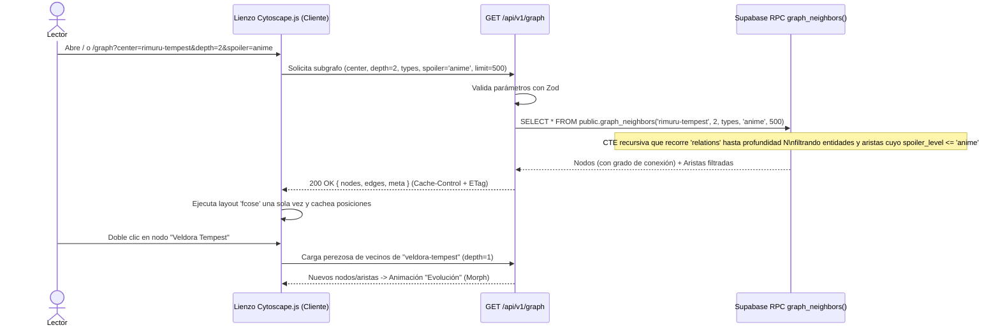

# Arquitectura del Sistema — Tempest Archive (`docs/ARCHITECTURE.md`)

Este documento describe la arquitectura técnica de punta a punta de **Tempest Archive**, siguiendo la **Sección 14 (Supabase + Vercel)** como arquitectura prioritaria y preservando el diseño en capas, la validación estricta con Zod y el estándar de errores **RFC 9457 (Problem Details)**.

---

## 1. Diagrama General de Contenedores y Servicios (Mermaid)



---

## 2. Estructura de Capas en el Servidor (`apps/web/src/server/`)

Aunque los endpoints viven dentro de Next.js (`apps/web/src/app/api/v1/*`) conforme a la Sección 14.2, el código mantiene la **separación estricta en 4 capas** exigida en la Sección 5 (cero lógica de negocio dentro de los archivos `route.ts`):

```text
apps/web/src/
├─ app/
│  ├─ api/v1/                 # 1. Capa de Rutas (Route Handlers HTTP)
│  │  ├─ health/route.ts
│  │  ├─ entities/route.ts
│  │  ├─ entities/[slug]/route.ts
│  │  ├─ entities/[slug]/revisions/route.ts
│  │  ├─ revisions/[id]/diff/route.ts
│  │  ├─ revisions/[id]/approve/route.ts
│  │  ├─ relations/route.ts
│  │  ├─ graph/route.ts
│  │  ├─ search/route.ts
│  │  ├─ media/route.ts
│  │  ├─ mod/queue/route.ts
│  │  ├─ reports/route.ts
│  │  └─ admin/...
├─ server/
│  ├─ controllers/            # 2. Capa de Controladores (parseo Zod, respuestas HTTP, ETag/Cache)
│  ├─ services/               # 3. Capa de Servicios (reglas de negocio, RBAC, diff, cálculo de caminos)
│  ├─ repositories/           # 4. Capa de Repositorios (consultas tipadas a Supabase Postgres / RPC)
│  └─ middleware/             # Rate-limiting por IP/usuario, manejo de errores RFC 9457 y auditoría
```

### Estándar de Errores: RFC 9457 (Problem Details)

Toda respuesta de error (`4xx` o `5xx`) en `/api/v1/*` devuelve `Content-Type: application/problem+json` utilizando `createProblemDetails()` de `@tempest-archive/shared`:

```json
{
  "type": "https://tempest-archive.vercel.app/probs/http-422",
  "title": "Datos de entrada inválidos",
  "status": 422,
  "detail": "El campo 'summary' no puede superar los 280 caracteres.",
  "instance": "/api/v1/entities",
  "errors": {
    "summary": ["Máximo 280 caracteres permitidos"]
  }
}
```

---

## 3. Flujos Principales (Diagramas de Secuencia)

### 3.1 Flujo de Edición y Moderación de Artículos



### 3.2 Flujo del Grafo Interactivo y Filtro Antispoiler



---

## 4. Estrategia de Rendimiento, Caché y Límites de Hardware

1. **Adaptación a 3.84 GB de RAM en Desarrollo:**
   - Un único servidor local (`next dev` con Turbopack) sin contenedores Docker ni procesos duplicados.
   - Base de datos delegada a Supabase Cloud (`hgibmdokzoihofbkcajy`).
2. **Rendimiento del Grafo:**
   - Límite duro de `500` nodos por consulta inicial en el RPC `graph_neighbors`.
   - Posiciones calculadas por `fcose` cacheadas en memoria (`Map<string, Position>`) por combinación de filtros para mantener **60 fps**.
3. **Búsqueda Híbrida (`tsvector` + `pg_trgm`):**
   - La función SQL `search_entities(query_text, filter_type, max_spoiler, result_limit)` combina `websearch_to_tsquery('spanish', unaccent(query_text))` sobre el índice GIN `search_vector` con `similarity(unaccent(name), unaccent(query_text)) > 0.25` (`pg_trgm`), logrando tiempos de respuesta `p95 < 100 ms`.
