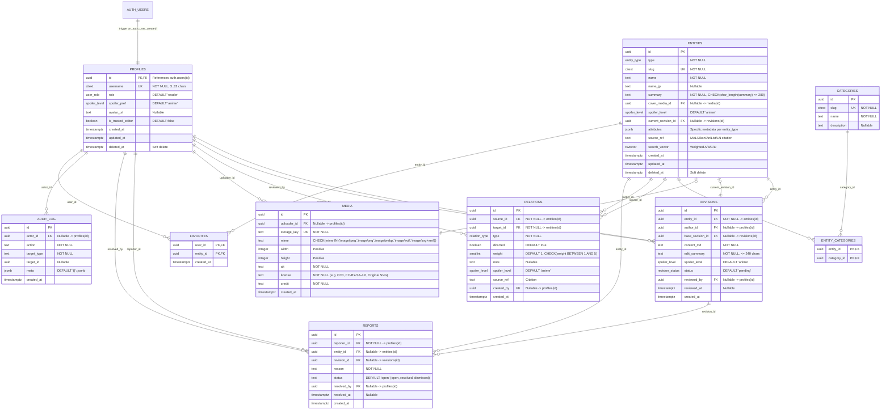

# Modelo Entidad-Relación (ERD) y Seguridad RLS — Tempest Archive (`docs/ERD.md`)

Este documento especifica el esquema completo de la base de datos PostgreSQL 17 en **Supabase**, alineando los requisitos de datos de la **Sección 6** con la arquitectura destino de la **Sección 14** (`auth.users` + `public.profiles`, funciones RPC y políticas RLS obligatorias).

---

## 1. Extensiones y Enums de PostgreSQL

### Extensiones requeridas

- `pgcrypto`: Generación de UUIDs criptográficos (`gen_random_uuid()`).
- `citext`: Comparación insensible a mayúsculas/minúsculas para `username` y `slug`.
- `unaccent`: Normalización de tildes y diacríticos en español para búsqueda de texto completo.
- `pg_trgm`: Similitud por trigramas para tolerancia a errores de escritura (_typo-tolerance_).

### Enums del Dominio (`public`)

- `user_role`: `'reader'`, `'editor'`, `'moderator'`, `'admin'`
- `entity_type`: `'character'`, `'race'`, `'skill'`, `'nation'`, `'organization'`, `'arc'`, `'location'`, `'item'`
- `spoiler_level`: `'none'`, `'anime'`, `'novel'`
- `revision_status`: `'pending'`, `'approved'`, `'rejected'`
- `relation_type`: `'evolves_into'`, `'member_of'`, `'serves'`, `'rules'`, `'ally_of'`, `'enemy_of'`, `'family_of'`, `'has_skill'`, `'belongs_to_race'`, `'appears_in'`, `'located_in'`

---

## 2. Diagrama Entidad-Relación (Mermaid `erDiagram`)

---

## 3. Restricciones e Índices Clave

1. **Restricciones en `relations`:**
   - `CONSTRAINT relations_unique_edge UNIQUE (source_id, target_id, type)`
   - `CONSTRAINT relations_no_self_loop CHECK (source_id <> target_id)`
   - `CONSTRAINT relations_weight_range CHECK (weight >= 1 AND weight <= 5)`
2. **Índices de Búsqueda y Rendimiento:**
   - `idx_entities_search_vector`: Índice **GIN** sobre `entities(search_vector)`.
   - `idx_entities_name_trgm`: Índice **GIN** (`gin_trgm_ops`) sobre `entities(name)`.
   - `idx_entities_name_jp_trgm`: Índice **GIN** (`gin_trgm_ops`) sobre `entities(name_jp)`.
   - `idx_entities_type`: Índice B-Tree sobre `entities(type) WHERE deleted_at IS NULL`.
   - `idx_relations_source`: Índice B-Tree sobre `relations(source_id)`.
   - `idx_relations_target`: Índice B-Tree sobre `relations(target_id)`.
   - `idx_revisions_entity_created`: Índice B-Tree sobre `revisions(entity_id, created_at DESC)`.
3. **Búsqueda Ponderada (`search_vector`):**
   - Trigger `entities_search_vector_update` que combina:
     - Peso **A**: `unaccent(coalesce(name, ''))`
     - Peso **B**: `unaccent(coalesce(name_jp, ''))`
     - Peso **C**: `unaccent(coalesce(summary, ''))`
     - Peso **D**: `unaccent(coalesce(current_revision_content, ''))`

---

## 4. Matriz de Seguridad Row Level Security (RLS) por Rol

Todas las tablas de `public` tienen `ENABLE ROW LEVEL SECURITY`. La verificación de roles usa la función segura `public.has_role(allowed_roles user_role[])` con `SECURITY DEFINER` y `SET search_path = public, pg_temp`.

| Tabla                              | `anon` (Visitante)               | `reader` (Lector)                                                          | `editor` (Editor)                                                                                      | `moderator` (Moderador)                                                        | `admin` (Administrador)                           |
| ---------------------------------- | -------------------------------- | -------------------------------------------------------------------------- | ------------------------------------------------------------------------------------------------------ | ------------------------------------------------------------------------------ | ------------------------------------------------- |
| `profiles`                         | `SELECT` (perfiles activos)      | `SELECT`, `UPDATE` propio (`spoiler_pref`, `avatar_url`, **nunca `role`**) | Igual que `reader`                                                                                     | Igual que `reader`                                                             | `SELECT`, `UPDATE` todos (incl. cambio de `role`) |
| `entities`                         | `SELECT` (`deleted_at IS NULL`)  | `SELECT` (`deleted_at IS NULL`)                                            | `SELECT`, `INSERT` (nuevas entidades)                                                                  | `SELECT`, `INSERT`, `UPDATE`                                                   | `SELECT`, `INSERT`, `UPDATE`, `DELETE` (soft)     |
| `revisions`                        | `SELECT` (`status = 'approved'`) | `SELECT` (`status = 'approved'` o propias)                                 | `SELECT` (aprobadas o propias), `INSERT` (`status = 'pending'`, o `'approved'` si `is_trusted_editor`) | `SELECT` todas, `INSERT` (`approved`), `UPDATE` (`approve`/`reject`/`restore`) | Control total                                     |
| `categories` / `entity_categories` | `SELECT`                         | `SELECT`                                                                   | `SELECT`, `INSERT` en `entity_categories`                                                              | `SELECT`, `INSERT`, `UPDATE`, `DELETE`                                         | Control total                                     |
| `relations`                        | `SELECT`                         | `SELECT`                                                                   | `SELECT`, `INSERT` (`created_by = auth.uid()`)                                                         | `SELECT`, `INSERT`, `UPDATE`, `DELETE`                                         | Control total                                     |
| `media`                            | `SELECT`                         | `SELECT`                                                                   | `SELECT`, `INSERT` (`uploader_id = auth.uid()`)                                                        | `SELECT`, `INSERT`, `DELETE`                                                   | Control total                                     |
| `reports`                          | Ninguno                          | `INSERT` (`reporter_id = auth.uid()`), `SELECT` propios                    | Igual que `reader`                                                                                     | `SELECT` todos, `UPDATE` (`status`, `resolved_by`)                             | Control total                                     |
| `favorites`                        | Ninguno                          | `SELECT`, `INSERT`, `DELETE` propios (`user_id = auth.uid()`)              | Igual que `reader`                                                                                     | Igual que `reader`                                                             | Igual que `reader`                                |
| `audit_log`                        | Ninguno                          | Ninguno                                                                    | Ninguno                                                                                                | `SELECT`                                                                       | `SELECT`, `INSERT`                                |
| `system_status`                    | `SELECT`                         | `SELECT`                                                                   | `SELECT`                                                                                               | `SELECT`                                                                       | `SELECT`, `UPDATE`                                |

### Protección Anti-Escalada de Privilegios en `profiles`

- Además de la política RLS de `UPDATE`, un trigger `BEFORE UPDATE ON public.profiles` impide que cualquier usuario cuyo rol actual no sea `'admin'` modifique las columnas `role` o `is_trusted_editor`.
